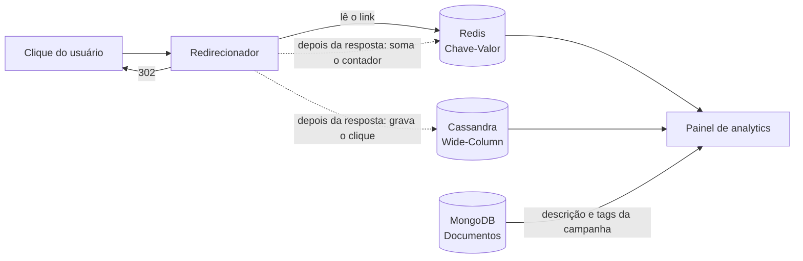

# LinkPulse

Encurtador de URLs voltado para equipes de marketing digital que divulgam a mesma campanha em vários canais e precisam acompanhar, quase em tempo real, o desempenho de cada link individualmente.

> Projeto incremental da disciplina Bancos de Dados NoSQL — CEUB, Campus Asa Norte.
> Integrantes: Eduardo Manzur, Gabriel Becker, Guilherme Rocha, Guilherme Vieira.

## Por que existe

Encurtadores genéricos resolvem o redirecionamento, mas não o problema real de um time de marketing: saber **quais canais trazem mais cliques**, com o link disponível mesmo sob pico de tráfego de campanha. Detalhes em [VISAO](docs/produto/VISAO.md).

## Início rápido

Precisa do Docker com o Compose e, para preparar a base e rodar as medições, de Python 3.11 ou mais novo no computador. Os comandos rodam na raiz do repositório.

```sh
docker compose up -d --wait          # sobe Redis (master e réplica), Cassandra, PostgreSQL e MongoDB
docker compose run --rm verificar    # confere bancos, esquemas e configuração
python benchmark/base.py carregar    # carrega a base de referência do benchmark nos dois lados
```

A primeira subida leva pouco mais de 1 minuto, quase todo esperando o Cassandra. A carga da base leva cerca de 10 minutos. A base ocupa cerca de 2,8 GB em disco, e a cópia guardada para restaurá-la ocupa outro tanto. O comando `carregar` recria os volumes do benchmark e preserva os dados de desenvolvimento. Depois da primeira carga, use `python benchmark/medir.py` para restaurar a cópia e medir as quatro operações. Para voltar aos dados de desenvolvimento, rode de novo `docker compose up -d --wait`. Passo a passo e problemas comuns no [guia](docs/GUIA.md#como-rodar).

## Guia do projeto

Resumo de cada parte do projeto. O [GUIA](docs/GUIA.md) explica cada uma com mais detalhe e aponta para os documentos de origem.

### Como o projeto foi feito

<a id="roadmap"></a>Antes de implementar uma funcionalidade, o grupo registra [o que ela deve fazer](docs/requisitos/REQUISITOS.md) e aprova uma [especificação com critérios para testá-la](docs/specs/README.md). As escolhas de arquitetura ficam no [registro de decisões](docs/decisoes/README.md). Consulte o [plano de tarefas](docs/roadmap/ROADMAP.md) para acompanhar as entregas e as [questões em aberto](docs/requisitos/QUESTOES.md) para saber o que ainda precisa de decisão.

### Como o sistema funciona



- **Redis (Chave-Valor):** link, contador de cliques e clientes. Fica no caminho de cada clique e precisa responder em milissegundos.
- **Cassandra (Wide-Column):** histórico de cliques, organizado para responder "cliques deste link em um período" lendo uma única partição: o grupo de linhas de um mesmo link, guardado junto e em ordem de data.
- **MongoDB (Documentos):** descrição e tags das campanhas, um dado que muda ao longo do tempo, ao contrário do clique.
- **PostgreSQL:** só no benchmark, como base de comparação relacional.

Justificativa completa em [ARQUITETURA](docs/arquitetura/ARQUITETURA.md) e fluxos em [FUNCIONALIDADES](docs/arquitetura/FUNCIONALIDADES.md). Mais em [Como o sistema funciona](docs/GUIA.md#como-o-sistema-funciona).

### Como rodar

Há dois conjuntos de dados para os mesmos bancos: os volumes de desenvolvimento, usados por `docker compose up -d --wait`, e os volumes do benchmark, usados pelos comandos de `python benchmark/base.py`. Ambiente local em [infra/](infra/README.md), base do benchmark em [benchmark/](benchmark/README.md) e roteiro completo em [Como rodar](docs/GUIA.md#como-rodar).

### Como testar e conferir

`docker compose run --rm verificar` confere o ambiente. `python benchmark/base.py conferir` confirma que os dois lados do benchmark têm os mesmos links e cliques, e `--completo` compara também a distribuição de dispositivos e uma assinatura calculada sobre todos os cliques. O gerador já registra a vazão, os tempos de resposta e os erros nos dois lados. Ainda faltam os testes da aplicação, a calibração do gerador e os cenários de pico de tráfego e de queda do Cassandra. Mais em [Como testar e conferir](docs/GUIA.md#como-testar-e-conferir).

### Como a aplicação funciona

A aplicação ainda não foi implementada. A [especificação da aplicação](docs/specs/SPEC-004-aplicacao.md) prevê uma API em Python com FastAPI e uma página HTML para cadastrar clientes e campanhas, criar links, redirecionar, registrar cada clique e mostrar o painel. Mais em [Como a aplicação funciona](docs/GUIA.md#como-a-aplicação-funciona).

### Como analisar os resultados do benchmark

O gerador já compara quatro operações. Ele lê o link e incrementa o contador no Redis, grava e consulta o histórico de cliques no Cassandra e repete as mesmas operações no PostgreSQL. Para cada uma, registra quantas operações terminam com sucesso por segundo, quanto tempo levam e quantas falham.

A calibração, os cenários de pico e de queda do Cassandra e a tela de testes estão planejados. A meta no pico é completar as operações do lado NoSQL sem erros. Durante a queda do Cassandra, a meta é continuar redirecionando o usuário e manter o tempo de resposta abaixo de 50 ms em pelo menos 95% dos pedidos. Veja [como interpretar as medições e os limites da comparação](docs/GUIA.md#como-analisar-os-resultados-do-benchmark).

## Documentação

| Onde | O que tem |
| --- | --- |
| [docs/](docs/README.md) | Índice geral da documentação |
| [docs/GUIA.md](docs/GUIA.md) | Guia do projeto: processo, arquitetura, como rodar, conferir e analisar o benchmark |
| [docs/produto/](docs/produto/README.md) | Visão, pitch e regras da disciplina |
| [docs/arquitetura/](docs/arquitetura/README.md) | Modelagem de dados e fluxos |
| [docs/requisitos/](docs/requisitos/README.md) | Requisitos (RF, RNF, RN) e questões |
| [docs/decisoes/](docs/decisoes/README.md) | Registro de decisões (ADR) |
| [docs/specs/](docs/specs/README.md) | Especificações com plano e critérios de aceitação |
| [docs/roadmap/](docs/roadmap/README.md) | Marcos e tarefas |
| [infra/](infra/README.md) | Ambiente local em Docker Compose, versões fixadas e consumo medido |
| [benchmark/](benchmark/README.md) | Como preparar e conferir a base, rodar o gerador e ler as medições |

## Contribuindo

Regras de issues, branches, commits, PRs, revisão e merge em [CONTRIBUTING](CONTRIBUTING.md). Agentes de código seguem o [AGENTS](AGENTS.md).
