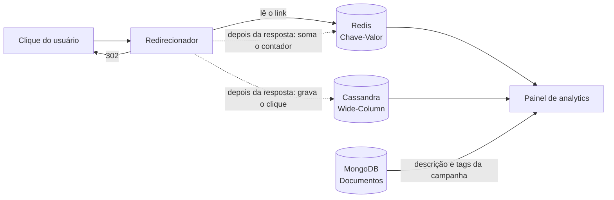

# LinkPulse

Encurtador de URLs voltado para equipes de marketing digital que divulgam a mesma campanha em vários canais e precisam acompanhar, quase em tempo real, o desempenho de cada link individualmente.

> Projeto incremental da disciplina Bancos de Dados NoSQL — CEUB, Campus Asa Norte.
> Integrantes: Eduardo Manzur, Gabriel Becker, Guilherme Rocha, Guilherme Vieira.

## Por que existe

Encurtadores genéricos resolvem o redirecionamento, mas não o problema real de um time de marketing: saber **qual canal está performando**, com o link disponível mesmo sob pico de tráfego de campanha. Detalhes em [VISAO](docs/produto/VISAO.md).

## Início rápido

Precisa do Docker com o Compose e, para a base do benchmark, de Python 3.11 ou mais novo no computador. Os comandos rodam na raiz do repositório.

```sh
docker compose up -d --wait          # sobe Redis (master e réplica), Cassandra, PostgreSQL e MongoDB
docker compose run --rm verificar    # confere bancos, esquemas e configuração
python benchmark/base.py carregar    # carrega a base de referência do benchmark nos dois lados
```

A primeira subida leva pouco mais de 1 minuto, quase todo esperando o Cassandra. A carga da base leva cerca de 10 minutos. A base ocupa cerca de 2,8 GB em disco, e a cópia guardada para restaurá-la ocupa outro tanto. A carga troca os volumes dos bancos pelos do benchmark; para voltar aos dados de desenvolvimento, rode de novo `docker compose up -d --wait`. Passo a passo e problemas comuns no [guia](docs/GUIA.md#como-rodar).

## Guia do projeto

Resumo de cada parte do projeto. O [GUIA](docs/GUIA.md) explica cada uma com mais detalhe e aponta para os documentos de origem.

### Como o projeto foi feito

<a id="roadmap"></a>O desenvolvimento é guiado por especificações ([ADR-0001](docs/decisoes/ADR-0001-desenvolvimento-guiado-por-especificacoes.md)): cada requisito tem origem e critério verificável em [REQUISITOS](docs/requisitos/REQUISITOS.md), cada decisão difícil de desfazer vira um registro de decisão (ADR) em [docs/decisoes/](docs/decisoes/README.md), e comportamento novo só é implementado com uma spec `Pronta` em [docs/specs/](docs/specs/README.md). As tarefas e os marcos ficam no [ROADMAP](docs/roadmap/ROADMAP.md), e as dúvidas ainda sem decisão, em [QUESTOES](docs/requisitos/QUESTOES.md). Mais em [Como o projeto foi feito](docs/GUIA.md#como-o-projeto-foi-feito).

### Como o sistema funciona



- **Redis (Chave-Valor):** link, contador de cliques e clientes. Fica no caminho de cada clique e precisa responder em milissegundos.
- **Cassandra (Wide-Column):** histórico de cliques, organizado para responder "cliques deste link em um período" lendo uma única partição: o grupo de linhas de um mesmo link, guardado junto e em ordem de data.
- **MongoDB (Documentos):** descrição e tags das campanhas, um dado que muda ao longo do tempo, ao contrário do clique.
- **PostgreSQL:** só no benchmark, como base de comparação relacional.

Justificativa completa em [ARQUITETURA](docs/arquitetura/ARQUITETURA.md) e fluxos em [FUNCIONALIDADES](docs/arquitetura/FUNCIONALIDADES.md). Mais em [Como o sistema funciona](docs/GUIA.md#como-o-sistema-funciona).

### Como rodar

Há dois conjuntos de dados para os mesmos bancos: os volumes de desenvolvimento, usados por `docker compose up -d --wait`, e os volumes do benchmark, usados pelos comandos de `python benchmark/base.py`. Ambiente local em [infra/](infra/README.md), base do benchmark em [benchmark/](benchmark/README.md) e roteiro completo em [Como rodar](docs/GUIA.md#como-rodar).

### Como testar e conferir

`docker compose run --rm verificar` confere o ambiente. `python benchmark/base.py conferir` confirma que os dois lados do benchmark têm os mesmos links e cliques, e `--completo` compara também a distribuição de dispositivos e uma assinatura calculada sobre todos os cliques. Os testes de aceitação da aplicação e do benchmark ainda serão escritos, junto com o código que eles testam. Mais em [Como testar e conferir](docs/GUIA.md#como-testar-e-conferir).

### Como a aplicação funciona

A aplicação ainda não foi implementada. A [SPEC-004](docs/specs/SPEC-004-aplicacao.md) prevê uma API em Python com FastAPI e uma página HTML para cadastrar clientes e campanhas, criar links, redirecionar, registrar cada clique e mostrar o painel. Mais em [Como a aplicação funciona](docs/GUIA.md#como-a-aplicação-funciona).

### Como analisar os resultados do benchmark

O benchmark mede quatro operações do produto (redirecionamento, contador, registro de clique e histórico por período) no Redis e no Cassandra e, para comparação, no PostgreSQL, com vazão, latência p50, p95 e p99 e taxa de erro ([ADR-0012](docs/decisoes/ADR-0012-marco-2-benchmark-sql-x-nosql.md)). O gerador de carga já mede as quatro operações; a calibração, os cenários e a tela de testes ainda não foram implementados ([SPEC-005](docs/specs/SPEC-005-testes-de-stress.md)). Não há placar esperado: os números entram na apresentação como saírem. Esperam-se zero erros no lado NoSQL no pico de tráfego e, com o Cassandra fora do ar, redirecionamentos respondendo `302` com p95 abaixo de 50 ms. Como ler os números e os limites da comparação em [Como analisar os resultados do benchmark](docs/GUIA.md#como-analisar-os-resultados-do-benchmark).

## Documentação

| Onde | O que tem |
| --- | --- |
| [docs/](docs/README.md) | Índice geral da documentação |
| [docs/GUIA.md](docs/GUIA.md) | Guia do projeto: processo, arquitetura, como rodar, conferir e analisar o benchmark |
| [docs/produto/](docs/produto/README.md) | Visão, pitch e regras da disciplina |
| [docs/arquitetura/](docs/arquitetura/README.md) | Modelagem de dados e fluxos |
| [docs/requisitos/](docs/requisitos/README.md) | Requisitos (RF, RNF, RN) e questões |
| [docs/decisoes/](docs/decisoes/README.md) | Registro de decisões (ADR) |
| [docs/specs/](docs/specs/README.md) | Especificações com plano e critérios de aceitação |
| [docs/roadmap/](docs/roadmap/README.md) | Marcos e tarefas |
| [infra/](infra/README.md) | Ambiente local em Docker Compose, versões fixadas e consumo medido |
| [benchmark/](benchmark/README.md) | Base de referência do benchmark: carga, cópia, restauração e conferência |

## Contribuindo

Regras de issues, branches, commits, PRs, revisão e merge em [CONTRIBUTING](CONTRIBUTING.md). Agentes de código seguem o [AGENTS](AGENTS.md).
